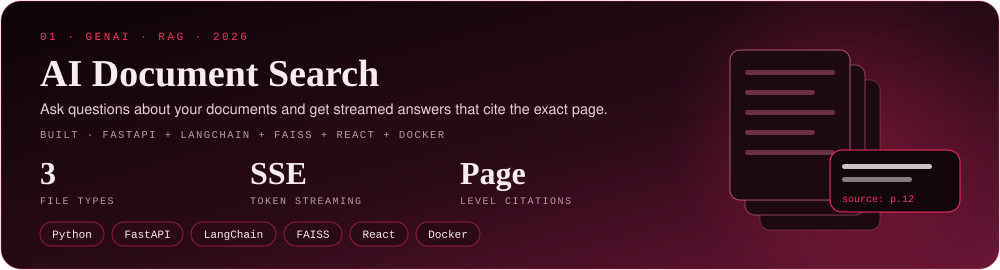
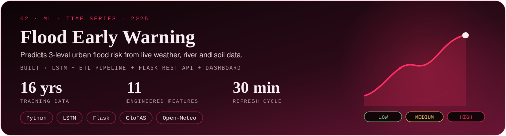
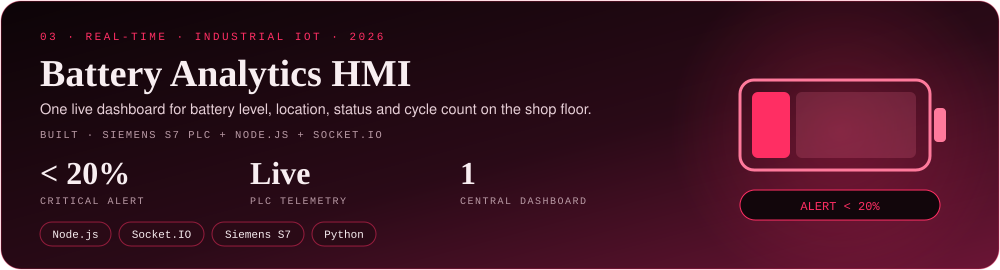
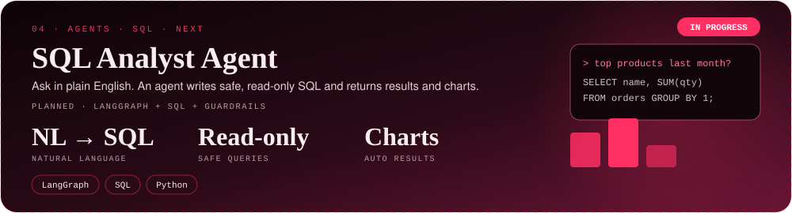
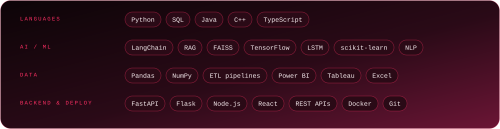
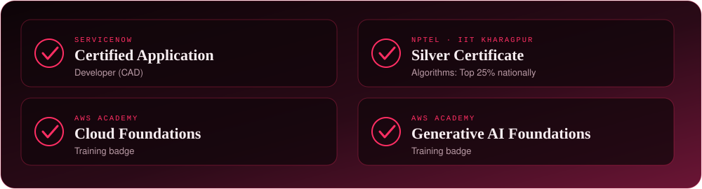

  
    

Interned at <b>Tata Motors</b> (RAG document search) and <b>Tata Cummins</b> (real-time PLC analytics)  ·  Open to <b>AI Engineer · ML Engineer · GenAI Developer · Data Analyst · Python Developer</b> roles

  

 <!-- TODO: after renaming the repos, update both links below -->

   

     
   
      
   
 

